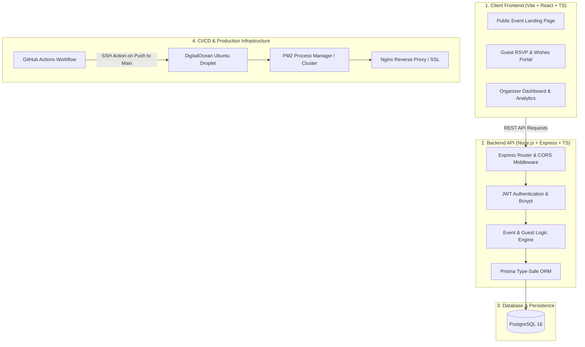

<div align="center">

# 💌 Chakyruu &mdash; B2B SaaS Digital Invitation & Event Management Platform

**Full-stack digital invitation suite with custom guest RSVP tracking, QR verification, real-time wishes feed, and automated CI/CD deployment.**

[](https://react.dev/)
[](https://www.typescriptlang.org/)
[](https://expressjs.com/)
[](https://www.prisma.io/)
[](https://www.postgresql.org/)
[](https://www.docker.com/)

</div>

---

## 📌 Executive Summary

**Chakyruu** is a production-ready B2B SaaS platform designed to eliminate paper invitations and modernize event logistics. It enables event organizers, couples, and corporate hosts to create bespoke interactive digital invitation experiences, track real-time attendance confirmations (RSVP), collect personalized wishes, and streamline guest check-ins with unique slug-based access.

---

## 🏗 System Architecture & Deployment Pipeline



---

## 🚀 Key Features

- **Monorepo Architecture:** Clean separation of concerns with `/client` (Vite, React, Tailwind, Axios) and `/server` (Express, Prisma, JWT, PostgreSQL).
- **Personalized Guest Links:** Unique slug generation per guest allowing individualized RSVP status (`Attending`, `Declined`, `Plus One`) and custom dietary requirements.
- **Interactive Guestbook & Wishes:** Live interactive stream of warm wishes and multimedia memories submitted by attendees.
- **Production-Ready CI/CD:** Fully automated push-to-deploy pipeline targeting DigitalOcean droplets with automated zero-downtime PM2 reloads.

---

## 💻 Tech Stack

| Layer | Technologies | Purpose |
| :--- | :--- | :--- |
| **Frontend** | **React 18, Vite, TypeScript, Tailwind CSS** | High-speed SPA with responsive mobile-first animations |
| **Backend** | **Express, Node.js 20, TypeScript** | RESTful API endpoints and authentication middleware |
| **Database & ORM** | **PostgreSQL, Prisma ORM** | Declarative schema, automated migrations, type-safe queries |
| **DevOps & Hosting** | **Docker Compose, PM2, GitHub Actions** | Local container parity and continuous production deployment |

---

## 📂 Repository File Structure

```plaintext
CHAKYRUU/
├── client/                     # Vite + React 18 + TypeScript frontend
│   ├── src/
│   │   ├── components/         # Reusable invitation cards, modals, countdown timers
│   │   ├── pages/              # Event landing, RSVP form, Admin dashboard
│   │   └── api/                # Axios API client instances
│   └── package.json
├── server/                     # Node.js + Express + Prisma backend
│   ├── prisma/
│   │   ├── schema.prisma       # Relational models (User, Event, Guest, Wish)
│   │   └── migrations/         # Database migration history
│   ├── src/                    # Controllers, middleware, routes, services
│   └── package.json
├── .github/workflows/          # GitHub Actions CI/CD automated deployment script
├── docker-compose.yml          # Container orchestration for App & PostgreSQL
├── ecosystem.config.js         # PM2 production process configuration
└── README.md                   # System documentation
```

---

## ⚡ Quickstart & Local Setup

### Option 1: Docker Compose (Recommended)
```bash
# 1. Clone repo and copy environment template
git clone https://github.com/Nekono3/CHAKYRUU.git
cd CHAKYRUU
cp .env.example .env

# 2. Build and run containers
docker compose up --build
```
API running at `http://localhost:4000`, Client at `http://localhost:3000`.

### Option 2: Native Node.js & Prisma
```bash
# Install dependencies across monorepo workspaces
npm install

# Run database migrations
npm run prisma:migrate:dev --workspace=server

# Start both client and server in parallel
npm run dev
```

---

## 👨‍💻 Author & Contributors

- **Belek Tazhibaev (Blake)** &mdash; Full-Stack Software Engineer
- **GitHub:** [@Nekono3](https://github.com/Nekono3)
- **Telegram:** [@Chromatic_s](https://t.me/Chromatic_s)
- **Email:** [tazhibaev0909@gmail.com](mailto:tazhibaev0909@gmail.com)
